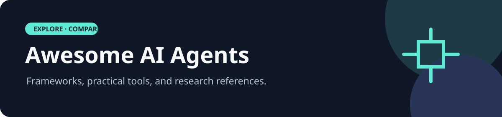

# 🤖 Awesome AI Agents

> A community-maintained directory of AI agent frameworks, developer tools, local runtimes, and research resources.

> Reviewed descriptions and repository structure: 2026-11-26. Entries are discovery references, not performance rankings.

---

## Why this repo exists

This repository collects tools and references for exploring AI agents. Inclusion is not an endorsement or a claim that a tool has been independently benchmarked.

It exists to help developers, researchers, founders, and AI builders quickly find:
- agent frameworks
- coding assistants
- browser and computer-use agents
- memory and knowledge systems
- MCP/tool-use ecosystems
- self-hosted local stacks
- learning resources and evaluation tools

This repo is for discovery and comparison. It includes open-source, source-available, and commercial tools. A public repository does not by itself establish an open-source license; inspect each project's license, hosting requirements, and current pricing. Free software may still require paid inference or infrastructure.

Historical or archived entries are labeled when identified. Maintenance status and service terms can change; check the linked source before adopting a tool.

---

## How to use this repo

Use this repo as a:
- starting point for building agentic systems
- curated shortlist for future research
- comparison guide across tools and platforms
- living directory of trending AI agent ecosystems

If you're looking for a tool, go to the relevant section below.

---

## Starting points (unranked)

### Agent frameworks
- [LangGraph](https://github.com/langchain-ai/langgraph)
- [AutoGen](https://github.com/microsoft/autogen)
- [CrewAI](https://github.com/crewAIInc/crewAI)
- [OpenAI Agents SDK](https://github.com/openai/openai-agents-python)
- [Semantic Kernel](https://github.com/microsoft/semantic-kernel)
- [PydanticAI](https://github.com/pydantic/pydantic-ai)

### Coding assistants
- [GitHub Copilot](https://github.com/features/copilot)
- [Cursor](https://cursor.com/)
- [Claude Code](https://github.com/anthropics/claude-code)
- [OpenHands](https://github.com/OpenHands/OpenHands)
- [Codex CLI](https://github.com/openai/codex)
- [Aider](https://github.com/Aider-AI/aider)

### Browser and computer-use tools
- [Browser Use](https://github.com/browser-use/browser-use)
- [Playwright MCP](https://github.com/microsoft/playwright-mcp)
- [Skyvern](https://github.com/Skyvern-AI/skyvern)
- [Stagehand](https://github.com/browserbase/stagehand)

### Memory and knowledge tools
- [Mem0](https://github.com/mem0ai/mem0)
- [Zep](https://github.com/getzep/zep)
- [Graphiti](https://github.com/getzep/graphiti)
- [Chroma](https://github.com/chroma-core/chroma)
- [Qdrant](https://github.com/qdrant/qdrant)
- [Weaviate](https://github.com/weaviate/weaviate)

### Local and self-hosted systems
- [Ollama](https://github.com/ollama/ollama)
- [Open WebUI](https://github.com/open-webui/open-webui)
- [Dify](https://github.com/langgenius/dify)
- [Flowise](https://github.com/FlowiseAI/Flowise)
- [AnythingLLM](https://github.com/Mintplex-Labs/anything-llm)
- [LocalAI](https://github.com/mudler/LocalAI)

---

## Table of Contents

- [🤖 Agent Frameworks](#-agent-frameworks)
- [🧠 Multi-Agent Systems](#-multi-agent-systems)
- [💻 Coding Agents](#-coding-agents)
- [🌐 Browser & Computer Use](#-browser--computer-use)
- [🔧 Tool Use & MCP](#-tool-use--mcp)
- [🧠 Memory & Knowledge](#-memory--knowledge)
- [🏠 Local & Self-Hosted Agents](#-local--self-hosted-agents)
- [📈 Agent Evaluation & Observability](#-agent-evaluation--observability)
- [📚 Learning Resources](#-learning-resources)
- [🎥 Demo Videos & Showcases](#-demo-videos--showcases)
- [🤝 Contributing](#-contributing)

---

## 🤖 Agent Frameworks

*Production-oriented frameworks for building AI agents and autonomous app experiences.*

| Name | Description | Stars |
|------|-------------|-------|
| [LangChain](https://github.com/langchain-ai/langchain) | Enterprise-friendly ecosystem for LLM apps, chains, tools, and agent workflows. |  |
| [LangGraph](https://github.com/langchain-ai/langgraph) | Graph-based orchestration for stateful and long-running agent systems. |  |
| [AutoGen](https://github.com/microsoft/autogen) | Microsoft’s multi-agent framework for conversational, collaborative agent systems. |  |
| [CrewAI](https://github.com/crewAIInc/crewAI) | Role-based orchestration platform for teams of AI agents working together. |  |
| [OpenAI Agents SDK](https://github.com/openai/openai-agents-python) | Official OpenAI SDK for agent handoffs, guardrails, tools, and orchestration. |  |
| [Semantic Kernel](https://github.com/microsoft/semantic-kernel) | Microsoft’s enterprise-ready SDK for LLM apps and agentic workflows. |  |
| [PydanticAI](https://github.com/pydantic/pydantic-ai) | Type-safe, structured AI app framework built around Pydantic and Python. |  |
| [Agno](https://github.com/agno-agi/agno) | Lightweight agent framework with structured reasoning and multi-modal capabilities. |  |
| [Smolagents](https://github.com/huggingface/smolagents) | Minimal, code-first agent framework from Hugging Face. |  |
| [DSPy](https://github.com/stanfordnlp/dspy) | Stanford framework for optimizing LM pipelines and agentic reasoning. |  |
| [MetaGPT](https://github.com/FoundationAgents/MetaGPT) | Multi-agent system that assigns specialized roles like PM, architect, and engineer. |  |
| [Camel](https://github.com/camel-ai/camel) | Communicative AI framework for collaborative multi-agent behavior and simulations. |  |
| [Letta](https://github.com/letta-ai/letta) | Stateful agent framework with long-term memory and persistent behavior. |  |
| [Haystack](https://github.com/deepset-ai/haystack) | RAG-first LLM framework for enterprise AI apps and applications with agents. |  |
| [AgentScope](https://github.com/agentscope-ai/agentscope) | Distributed multi-agent platform from Alibaba ModelScope. |  |
| [SuperAGI](https://github.com/TransformerOptimus/SuperAGI) | Open-source autonomous agent framework with GUI and concurrency features. |  |
| [AutoGPT](https://github.com/Significant-Gravitas/AutoGPT) | One of the original autonomous agent projects for goal-driven workflows. |  |
| [BabyAGI](https://github.com/yoheinakajima/babyagi) | Lightweight task-driven agent loop for autonomous planning and execution. |  |

---

## 🧠 Multi-Agent Systems

*Systems designed for agents to collaborate, negotiate, plan, and coordinate tasks.*

| Name | Description | Stars |
|------|-------------|-------|
| [AutoGen](https://github.com/microsoft/autogen) | Multi-agent conversation framework for solving complex workflows. |  |
| [CrewAI](https://github.com/crewAIInc/crewAI) | Role-based orchestration with collaborative worker agents. |  |
| [MetaGPT](https://github.com/FoundationAgents/MetaGPT) | Multi-agent software development simulation with role separation. |  |
| [Camel](https://github.com/camel-ai/camel) | Communicative agents framework for multi-agent simulations and collaboration. |  |
| [AgentScope](https://github.com/agentscope-ai/agentscope) | Research and production-ready multi-agent system with distributed execution patterns. |  |
| [FinRobot](https://github.com/AI4Finance-Foundation/FinRobot) | Agent framework for financial research and multi-agent workflows. |  |
| [OpenAI Swarm (historical)](https://github.com/openai/swarm) | Educational handoff framework; its README directs new projects to the OpenAI Agents SDK. |  |

---

## 💻 Coding Agents

*Tools that write, debug, review, plan, and deploy code automatically.*

| Name | Description | Stars |
|------|-------------|-------|
| [GitHub Copilot](https://github.com/features/copilot) | AI pair programmer and coding assistant for real-world coding workflows. |  |
| [Cursor](https://cursor.com/) | AI-native code editor built for code generation, fixes, and multi-file editing. |  |
| [Claude Code](https://github.com/anthropics/claude-code) | Anthropic's agentic coding CLI working inside your terminal. |  |
| [OpenHands](https://github.com/OpenHands/OpenHands) | Open-source software engineering agent for coding, command execution, and issue resolution. |  |
| [Codex CLI](https://github.com/openai/codex) | OpenAI’s terminal-based coding agent for local and repo-based software development. |  |
| [Aider](https://github.com/Aider-AI/aider) | AI pair programmer for terminal workflows and git-based repos. |  |
| [SWE-agent](https://github.com/SWE-agent/SWE-agent) | Research and tooling for autonomously resolving GitHub issues in repos. |  |
| [Continue](https://github.com/continuedev/continue) | Open-source AI code assistant for VS Code and JetBrains. |  |
| [Cline](https://github.com/cline/cline) | Coding agent for editor workflows with terminal/tool access. |  |
| [Plandex](https://github.com/plandex-ai/plandex) | Terminal-first coding engine for multi-step project work. |  |
| [Goose](https://github.com/aaif-goose/goose) | Block’s local AI dev agent with tool integrations and workflow automation. |  |
| [Void](https://github.com/voideditor/void) | Open-source AI code editor built for agentic software development. |  |
| [Devin](https://devin.ai/) | Autonomous software engineer designed for project completion tasks. |  |
| [Bolt.new](https://bolt.new/) | AI app builder that creates a working stack from natural-language prompts. |  |
| [Lovable](https://lovable.dev/) | AI full-stack engineer for turning prompts into deployable apps. |  |
| [Windsurf](https://windsurf.com/) | Code editor with AI-assisted coding workflows. |  |

---

## 🌐 Browser & Computer Use

*Agents that use the browser, desktop, or web tools to complete tasks autonomously.*

| Name | Description | Stars |
|------|-------------|-------|
| [agent-qa](https://vostride.com) | Web and mobile QA through CLI/MCP, with persistent memidex memory, validated self-improvement and reviewable evidence. |  |
| [Browser Use](https://github.com/browser-use/browser-use) | Open-source browser automation and web-interaction framework for AI agents. |  |
| [Playwright MCP](https://github.com/microsoft/playwright-mcp) | MCP server exposing browser automation for LLM-powered workflows. |  |
| [Skyvern](https://github.com/Skyvern-AI/skyvern) | Browser automation with AI-driven reasoning and computer-vision navigation. |  |
| [AgentQL](https://github.com/tinyfish-io/agentql) | Query language for extracting structured data from webpages for agents. |  |
| [Stagehand](https://github.com/browserbase/stagehand) | AI web automation using Playwright and LLM-based element selection. |  |
| [Firecrawl](https://github.com/firecrawl/firecrawl) | Extract, crawl, and transform websites into LLM-ready structured data. |  |
| [Crawl4AI](https://github.com/unclecode/crawl4ai) | AI-oriented crawler for collecting web data for RAG and agent systems. |  |
| [Open Operator (archived)](https://github.com/browserbase/open-operator) | Browserbase web-agent demonstration; archived, with migration information in its README. |  |
| [Notte](https://github.com/nottelabs/notte) | AI-first browser environment for running web agents in scalable environments. |  |
| [The AGI Company / MultiOn](https://theagi.company/) | Product site reached from the former MultiOn domain; check current availability and terms. |  |

---

## 🔧 Tool Use & MCP

*Protocols, tool registries, APIs, and infrastructure used to equip agents with capabilities.*

| Name | Description | Stars |
|------|-------------|-------|
| [Agent Payment Node](https://github.com/nuanu-ai/agent-payment-node) | Local stdio MCP tools for x402 offers, bounded payments and receipts; Apple Silicon macOS and Node 24. |  |
| [Model Context Protocol (MCP)](https://github.com/modelcontextprotocol/servers) | Open standard for connecting AI to tools, data, and systems. |  |
| [MCP Python SDK](https://github.com/modelcontextprotocol/python-sdk) | Official Python SDK for building MCP servers and clients. |  |
| [Composio](https://github.com/ComposioHQ/composio) | Managed tool integrations for AI agents with authentication and reliability layers. |  |
| [Arcade AI](https://github.com/ArcadeAI/arcade-mcp) | Tools and infrastructure for exposing reliable agent capabilities. |  |
| [Toolhouse](https://github.com/toolhouseai/toolhouse-sdk-python) | Cloud-native toolkit for tool execution, storage, and orchestration. |  |
| [Exa](https://github.com/exa-labs/exa-py) | AI-native search infrastructure used by agentic products and assistants. |  |
| [Tavily](https://github.com/tavily-ai/tavily-python) | Search API purpose-built for AI agents, retrieval, and grounded research. |  |
| [E2B Code Interpreter](https://github.com/e2b-dev/code-interpreter) | Sandboxed execution environment for running code in secure sandboxes. |  |
| [Daytona](https://github.com/daytonaio/daytona) | Secure cloud dev environments for AI-generated code execution. |  |
| [LangChain Tools](https://docs.langchain.com/oss/python/integrations/providers/overview) | Huge library of tool integrations for agent development in LangChain ecosystems. |  |
| [deed.page](https://github.com/f-o-x11/deed-page-skill) | Agent skill and remote MCP server that publish an agent's HTML or static folder to a permanent public URL in one request. |  |

---

## 🧠 Memory & Knowledge

*Systems that let agents persist memory, retrieve context, and reason over long-term knowledge.*

| Name | Description | Stars |
|------|-------------|-------|
| [Mem0](https://github.com/mem0ai/mem0) | Memory layer for AI assistants with memory recall and long-term personalization. |  |
| [Zep](https://github.com/getzep/zep) | Temporal memory and retrieval system for long-lived agent conversations. |  |
| [Graphiti](https://github.com/getzep/graphiti) | Temporal knowledge graph framework for evolving facts in agent memory. |  |
| [Chroma](https://github.com/chroma-core/chroma) | Open-source vector store for semantic memory and retrieval systems. |  |
| [Qdrant](https://github.com/qdrant/qdrant) | High-performance vector database for semantic memory and retrieval. |  |
| [Weaviate](https://github.com/weaviate/weaviate) | Cloud-native vector database with multi-modal retrieval capabilities. |  |
| [LlamaIndex](https://github.com/run-llama/llama_index) | Data framework for connecting LLMs to external knowledge sources and memory. |  |
| [LangMem](https://github.com/langchain-ai/langmem) | Memory management layer built for persistent agent experiences. |  |
| [Cognee](https://github.com/topoteretes/cognee) | Memory and knowledge engine for AI apps using structured knowledge layers. |  |
| [Ragflow](https://github.com/infiniflow/ragflow) | Open-source RAG engine for data-aware, memory-rich AI systems. |  |

---

## 🏠 Local & Self-Hosted Agents

*Run AI agents privately, locally, and fully on your own infrastructure.*

| Name | Description | Stars |
|------|-------------|-------|
| [Ollama](https://github.com/ollama/ollama) | Local LLM runtime used for private AI agents and local inference stacks. |  |
| [LocalAI](https://github.com/mudler/LocalAI) | Drop-in local OpenAI-compatible inference server for AI workloads. |  |
| [Open WebUI](https://github.com/open-webui/open-webui) | Self-hosted web interface for local chat, agents, and tool workflows. |  |
| [AnythingLLM](https://github.com/Mintplex-Labs/anything-llm) | Local-first AI app for docs, private data, and agentic interactions. |  |
| [LM Studio](https://lmstudio.ai/) | Desktop app for running and experimenting with local models. |  |
| [Jan](https://github.com/janhq/jan) | Offline-first local AI application for private use cases. |  |
| [GPT4All](https://github.com/nomic-ai/gpt4all) | Community-driven ecosystem for running local language models and AI locally. |  |
| [PrivateGPT](https://github.com/zylon-ai/private-gpt) | Private, local, document-focused AI app for secure retrieval and Q&A. |  |
| [Dify](https://github.com/langgenius/dify) | Open-source platform for building AI flows, apps, and agent workflows. |  |
| [Flowise](https://github.com/FlowiseAI/Flowise) | Visual builder for workflows, agents, and AI apps. |  |
| [n8n AI Agents](https://github.com/n8n-io/n8n) | Workflow automation with AI agent features and self-hosting support. |  |
| [Text Generation WebUI](https://github.com/oobabooga/textgen) | Local web UI for running LLMs with custom extensions and tools. |  |
| [Orkas](https://github.com/Orkas-AI/Orkas) | Local-first desktop AI workforce for planning and multi-agent orchestration. |  |

---

## 📈 Agent Evaluation & Observability

*The tools used to test, evaluate, debug, monitor, and gain visibility into AI agent performance.*

| Name | Description | Stars |
|------|-------------|-------|
| [Langfuse](https://github.com/langfuse/langfuse) | LLM observability and tracing platform for agent workflows and prompts. |  |
| [Helicone](https://github.com/Helicone/helicone) | Logging and monitoring stack for LLM and agent usage. |  |
| [OpenTelemetry](https://opentelemetry.io/) | Vendor-neutral observability specifications and instrumentation; not an agent-specific SDK. |  |
| [Arize Phoenix](https://github.com/Arize-ai/phoenix) | Observability for LLM apps and retrieval pipelines. |  |
| [Guardrails AI](https://github.com/guardrails-ai/guardrails) | Validation and safety tooling for structured outputs and agent behavior. |  |
| [Promptfoo](https://github.com/promptfoo/promptfoo) | LLM evaluation, benchmark, and prompt testing framework. |  |

---

## 📚 Learning Resources

*Books, papers, courses, articles, and tutorials that help you understand AI agents deeply.*

### Foundational papers
| Title | Description |
|-------|-------------|
| [ReAct: Synergizing Reasoning and Acting in Language Models](https://arxiv.org/abs/2210.03629) | Prompting method combining reasoning traces and tool use. |
| [Toolformer: Language Models Can Teach Themselves to Use Tools](https://arxiv.org/abs/2302.04761) | Early work showing models can use tools to improve their performance. |
| [HuggingGPT: Solving AI Tasks with ChatGPT and Its Friends](https://arxiv.org/abs/2303.17580) | Controller-based orchestration model for multi-model AI systems. |
| [Generative Agents: Interactive Simulacra of Human Behavior](https://arxiv.org/abs/2304.03442) | A landmark paper on persistent, social, autonomous agents. |
| [AgentBench: Evaluating LLMs as Agents](https://arxiv.org/abs/2308.03688) | Benchmark suite evaluating LLMs in agentic environments. |
| [SWE-bench](https://arxiv.org/abs/2310.06770) | Standard benchmark for code-repair agents on real GitHub issues. |
| [Chain-of-Thought Prompting Elicits Reasoning in Large Language Models](https://arxiv.org/abs/2201.11903) | Foundational reasoning paper that shaped modern agent behavior. |
| [Tree of Thoughts](https://arxiv.org/abs/2305.10601) | Deliberate search over multiple reasoning paths. |

### Courses & tutorials
| Title | Provider | Description |
|-------|----------|-------------|
| [AI Agents in LangGraph](https://www.deeplearning.ai/courses/ai-agents-in-langgraph) | DeepLearning.AI | Learn stateful agent workflows and decision-making with LangGraph. |
| [Multi AI Agent Systems with CrewAI](https://www.deeplearning.ai/courses/multi-ai-agent-systems-with-crewai) | DeepLearning.AI | Build collaborative multi-agent systems with CrewAI. |
| [AI Agentic Design Patterns with AutoGen](https://www.deeplearning.ai/courses/ai-agentic-design-patterns-with-autogen) | DeepLearning.AI | Learn patterns for multi-agent coordination and planning. |
| [Hugging Face Agents Course](https://huggingface.co/learn/agents-course/en/unit0/introduction) | Hugging Face | Practical, free training on modern agent patterns and tooling. |
| [LangChain Academy — Intro to LangGraph](https://academy.langchain.com/courses/intro-to-langgraph) | LangChain | Fast intro to graph-based agents and stateful workflows. |
| [Build Your Own Database Agent](https://www.deeplearning.ai/courses/building-your-own-database-agent) | DeepLearning.AI | Learn to build AI agents that interact with SQL and data systems. |

### Blogs & articles
| Title | Author | Description |
|-------|--------|-------------|
| [The Complete Guide to AI Agents](https://www.anthropic.com/research/building-effective-agents) | Anthropic | Practical guide to building effective agents with patterns and pitfalls. |
| [LLM Powered Autonomous Agents](https://lilianweng.github.io/posts/2023-06-23-agent/) | Lilian Weng | A conceptual survey of agent architectures. |
| [What are AI Agents?](https://aws.amazon.com/what-is/ai-agents/) | AWS | An overview of what agent systems are and where they fit. |
| [A Survey on LLM-based Autonomous Agents](https://arxiv.org/abs/2308.11432) | arXiv | Comprehensive academic review of the field. |

---

## 🎥 Demo Videos & Showcases

Use the maintainers' own demonstration pages and README examples. These links replace specific video IDs whose titles and authors were not verified.

| Project | Official examples and documentation |
| --- | --- |
| Stagehand | [Repository examples and documentation](https://github.com/browserbase/stagehand) |
| Browser Use | [Quick start and demonstrations](https://github.com/browser-use/browser-use) |
| Aider | [Project documentation](https://aider.chat/) |
| OpenAI Agents SDK | [Python examples](https://github.com/openai/openai-agents-python/tree/main/examples) |
| LangGraph | [Repository and linked guides](https://github.com/langchain-ai/langgraph) |

---

## 🤝 Contributing

Contributions are welcome and encouraged.

Please read [CONTRIBUTING.md](CONTRIBUTING.md) before submitting a pull request.

### Contribution checklist
Before opening a PR, make sure:
- the project is genuinely related to AI agents
- the link is official and active
- the description is clear, concise, and honest
- it fits the best category
- it is not a duplicate of an existing entry
- it is not abandoned or clearly low-quality

### Suggested categories
When adding a new project, place it under the most relevant section:
- agent frameworks
- coding agents
- browser/computer use
- tool use / MCP
- memory / knowledge
- local / self-hosted
- evaluation / observability
- learning resources

### Good contribution examples
- official repo or product link
- strong description
- real-world purpose
- active maintenance or proven relevance
- clear value to the AI agent ecosystem

---

## Repo standards

This repo is curated, not a dump of every AI-related project.

We prioritize:
- real-world relevance
- active maintenance
- strong documentation
- clear use case
- practical value
- ecosystem importance
- quality over quantity

We also flag or remove:
- stale projects
- repos with no meaningful maintenance
- duplicate entries
- dead links
- unrelated “AI” projects that are not actually agent tools

---

## Maintainer note

This repository aims to be:
- useful
- trustworthy
- current
- community-driven
- practical

If you are building with AI agents, you should be able to use this repo as a shortlist, reference list, or starting point for exploring the ecosystem.

---

**Maintained through community contributions**

## Maintainer checks

Run `python scripts/check_links.py` for local Markdown links and image paths. Add `--remote` to check external HTTP links; timeouts, authentication walls, and rate limits are reported for review and must not be treated as proof that a project is dead. Remote checks are opt-in and do not run automatically in pull-request CI.
